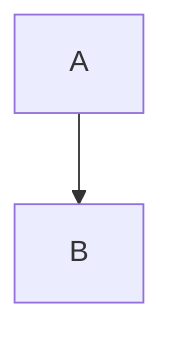

# Heading One

A paragraph with **bold**, *italic*, `code`, ~~strike~~, ==highlight==, H~2~O, x^2^, <u>underline</u>, a [link](https://example.com) and math $E=mc^2$ plus :smile: emoji[^1].

## Lists

- item one
- item two
  - nested item
- [ ] task open
- [x] task done

1. first
2. second
3. third

> A quote
> with two lines

> [!NOTE]
> An alert block.

```js
const a = 1;
function hello(name) { return `hi ${name}`; }
```

$$
\int_0^1 x^2 \, dx = \frac{1}{3}
$$

| Name | Value |
| :--- | ----: |
| a    | 1     |
| b    | 2     |

---


[TOC]



[^1]: The footnote text.
